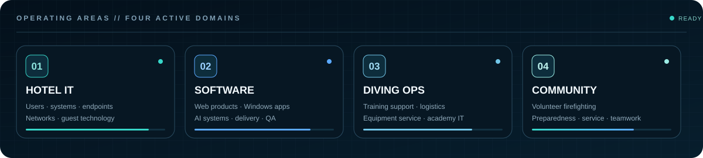
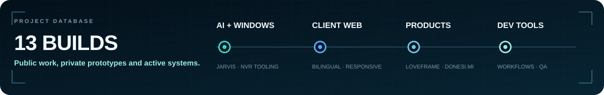
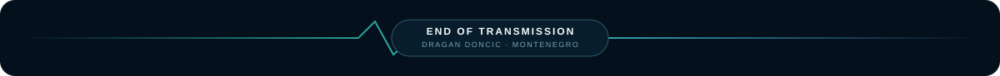

  

  
  
  
  

  <code>Montenegro</code>&nbsp;&nbsp;·&nbsp;&nbsp;<code>Hotel IT</code>&nbsp;&nbsp;·&nbsp;&nbsp;<code>Infrastructure</code>&nbsp;&nbsp;·&nbsp;&nbsp;<code>Software</code>&nbsp;&nbsp;·&nbsp;&nbsp;<code>Local-first AI</code>

## `> whoami`

I work in hotel IT at **Hyatt Regency Kotor Bay Resort**, supporting daily operations, users, networks, infrastructure and guest-facing technology. Alongside hotel IT, I design and build responsive web platforms, digital products and Windows software.

My work connects operational discipline with practical delivery: from **Microsoft 365, Opera PMS, Ruckus, D-Link and Hikvision** environments to **React, TypeScript, Python, FastAPI, GitHub Actions and Netlify**.

I also support diver training, equipment servicing and IT operations at **Boka Diving Academy**, and volunteer with **Dobrovoljno Vatrogasno Društvo Tivat**.

  

## `> flagship --open`

<table>
  <tr>
    <td width="50%" valign="top">
      <h3>01 · JARVIS</h3>
      
<strong>Local-first Windows AI assistant</strong>

      
Voice workflows, memory, privacy controls, approval-based actions and a protected coding workspace — designed to run on the user's own machine.

      
<code>Python</code> <code>FastAPI</code> <code>Windows</code> <code>WebView2</code> <code>AI</code>

      
<a href="https://github.com/Dado211207/jarvis-windows-ai-assistant"><strong>VIEW SOURCE →</strong></a>

    </td>
    <td width="50%" valign="top">
      <h3>02 · Boka Diving Academy</h3>
      
<strong>Bilingual academy and conservation platform</strong>

      
Diving courses, marine-conservation activities, articles and contact information inside a responsive Montenegrin/English experience.

      
<code>React</code> <code>TypeScript</code> <code>GSAP</code> <code>Netlify</code>

      
<a href="https://bokadive.com"><strong>OPEN LIVE SITE →</strong></a>

    </td>
  </tr>
  <tr>
    <td width="50%" valign="top">
      <h3>03 · dragandoncic.com</h3>
      
<strong>Bilingual professional portfolio</strong>

      
IT experience, software work, case studies and CV delivery with responsive layouts, localized routes, accessibility and release-quality testing.

      
<code>React</code> <code>TypeScript</code> <code>Vite</code> <code>Playwright</code>

      
<a href="https://dragandoncic.com"><strong>OPEN PORTFOLIO →</strong></a>

    </td>
    <td width="50%" valign="top">
      <h3>04 · TwinsLand</h3>
      
<strong>Client website in development</strong>

      
A bilingual website for Twins Land, a children's playroom and cafe in Mega Mall, built around cinematic motion and verified business content.

      
<code>React</code> <code>TypeScript</code> <code>GSAP</code> <code>Bilingual</code>

      
<a href="https://twinsland.netlify.app"><strong>OPEN PREVIEW →</strong></a>

    </td>
  </tr>
</table>

## `> projects --all`

  

| # | Project | State | What it is | Access |
|:--:|:--|:--|:--|:--|
| 01 | **JARVIS** | **BUILDING** | Local-first Windows AI assistant with voice, memory, approvals and coding tools. | [Source](https://github.com/Dado211207/jarvis-windows-ai-assistant) |
| 02 | **Boka Diving Academy** | **LIVE** | Bilingual diving-training and marine-conservation platform. | [Website](https://bokadive.com) |
| 03 | **dragandoncic.com** | **LIVE** | Bilingual portfolio, case studies and downloadable CV. | [Website](https://dragandoncic.com) |
| 04 | **TwinsLand** | **CLIENT BUILD** | Bilingual children's playroom and cafe website with cinematic motion. | [Preview](https://twinsland.netlify.app) |
| 05 | **LoveFrame** | **DEMO LIVE** | Private, mobile-first digital gift experiences shared by link or QR code. | [Demo](https://loveframe-experience.netlify.app) |
| 06 | **Kotor Bay Whispers** | **LIVE** | Private boat-tour website designed for clear mobile discovery and contact. | [Website](https://kotor-bay-whispers.netlify.app/) |
| 07 | **Caritas Kotorske biskupije** | **LIVE** | Organization website work focused on structure and manageable content. | [Website](https://caritaskb.com) |
| 08 | **Hrvatska nastava Crna Gora** | **LIVE** | Classes, activities and updates for the school and parents' association. | [Website](https://www.hrvatska-nastava-crnagora.com) |
| 09 | **NVR Camera Organizer** | **PRIVATE PROTOTYPE** | Dashboard for organizing NVR cameras, locations and system settings. | Private build |
| 10 | **MILICA MICA** | **CLIENT PROTOTYPE** | Responsive restaurant presentation, menu, gallery and location experience. | Private build |
| 11 | **Donesi.Mi** | **PRODUCT PROTOTYPE** | Delivery-service landing experience with ordering flow, services and pricing. | Private build |
| 12 | **Dado Claude Toolkit** | **BUILDING** | Reusable Claude Code workflows, project skills and QA automation. | [Repository](https://github.com/Dado211207/dado-claude-toolkit) |

> Private repositories stay private. The archive shows the work without exposing source code, credentials, client data or private LoveFrame experiences.

## `> stack --grouped`

### Software and web

### Systems, delivery and quality

`Hotel IT operations` · `LAN / WLAN` · `D-Link & Ruckus` · `Opera PMS` · `Hikvision CCTV` · `Responsive design` · `Accessibility` · `SEO` · `Bilingual delivery`

## `> workflow --quality-first`

| 01 · Understand | 02 · Build | 03 · Verify | 04 · Ship | 05 · Support |
|:--|:--|:--|:--|:--|
| Real requirements and verified facts | Responsive, maintainable implementation | Cross-browser, accessibility and factual checks | CI, preview, review and controlled release | Monitoring, maintenance and practical fixes |

## `> current_mission`

- **JARVIS:** completing a dependable Windows release before moving to the mobile control layer.
- **Hotel IT:** supporting users, endpoints, networks and guest-facing systems.
- **Software delivery:** building bilingual web products with strong responsive, accessibility and release standards.
- **Development tooling:** creating reusable workflows that make future projects faster without lowering quality.

  

  <a href="https://dragandoncic.com"><strong>dragandoncic.com</strong></a>
  &nbsp;&nbsp;·&nbsp;&nbsp;
  <a href="https://www.linkedin.com/in/dragan-doncic/"><strong>LinkedIn</strong></a>
  &nbsp;&nbsp;·&nbsp;&nbsp;
  <a href="https://github.com/Dado211207/jarvis-windows-ai-assistant"><strong>JARVIS</strong></a>

