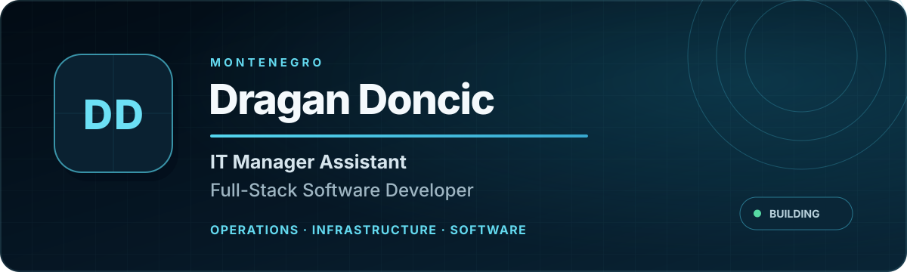
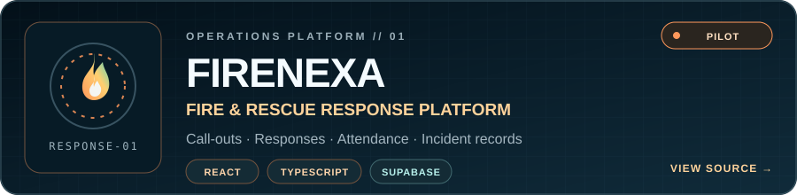
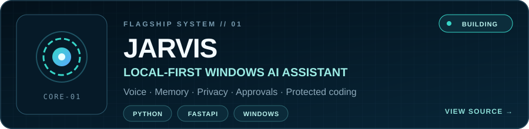
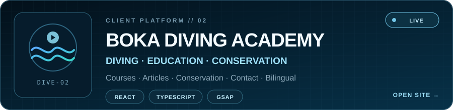
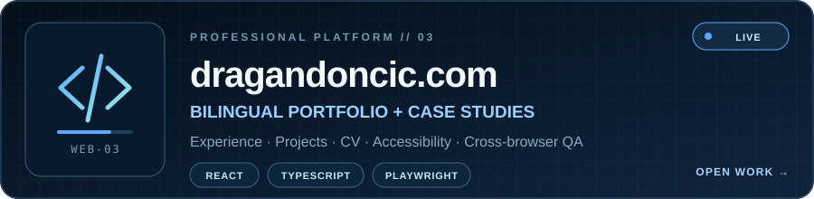

  

  <a href="https://dragandoncic.com">Portfolio</a> &nbsp;·&nbsp;
  <a href="https://dragandoncic.com/cv/">CV</a> &nbsp;·&nbsp;
  <a href="https://www.linkedin.com/in/dragan-doncic/">LinkedIn</a>

## About me

I'm **Dragan Doncic**, an IT Manager Assistant at **Hyatt Regency Kotor Bay Resort** and a software developer based in Montenegro. I work across hotel IT operations, networks, endpoints and guest technology, and build web products and local software with a focus on reliability and clear user experience.

My work spans operational support and product delivery: **Microsoft 365, Opera PMS, D-Link, Ruckus and Hikvision** in hotel environments; **React, TypeScript, Python, FastAPI, PostgreSQL/Supabase and GitHub Actions** in software projects. Outside work, I support Boka Diving Academy and volunteer with DVD Tivat.

## Selected work

**FireNexa** — A response coordination platform for authorized fire and rescue teams: call-outs, member responses, attendance and intervention records. **Operational pilot; not a public emergency reporting service.** [Case study](https://dragandoncic.com/projects/firenexa/) · [Source](https://github.com/Dado211207/dvd-tivat-app)

**JARVIS** — A Windows AI assistant with a local dashboard, memory, system tools and approval controls for sensitive actions. **In development.** [Source and documentation](https://github.com/Dado211207/jarvis-windows-ai-assistant)

**Boka Diving Academy** — A bilingual website for diving courses, academy information and marine conservation. [Live website](https://bokadive.com) · [Case study](https://dragandoncic.com/projects/boka-diving-academy/)

**Personal portfolio** — A bilingual, responsive site with project case studies and downloadable CV. [Explore the site](https://dragandoncic.com) · [View CV](https://dragandoncic.com/cv/)

### More website work

| Project | Focus | View |
|:--|:--|:--|
| Caritas Kotorske biskupije | Organization website and content structure | [Case study](https://dragandoncic.com/projects/caritas-kotorske-biskupije/) · [Website](https://caritaskb.com) |
| Hrvatska nastava Crna Gora | School information, activities and updates | [Case study](https://dragandoncic.com/projects/hrvatska-nastava-crna-gora/) · [Website](https://www.hrvatska-nastava-crnagora.com) |

## How I work

I turn real operational needs into usable tools, verify them with automated and hands-on testing, and document what is ready for people to use. In safety-sensitive work, a working demo and an approved operational release are different milestones.

**Core areas:** hotel IT and infrastructure · web and Windows software · bilingual interfaces · accessibility · test automation · controlled releases.

For more detail, screenshots and contact information, see **[dragandoncic.com](https://dragandoncic.com)**.
